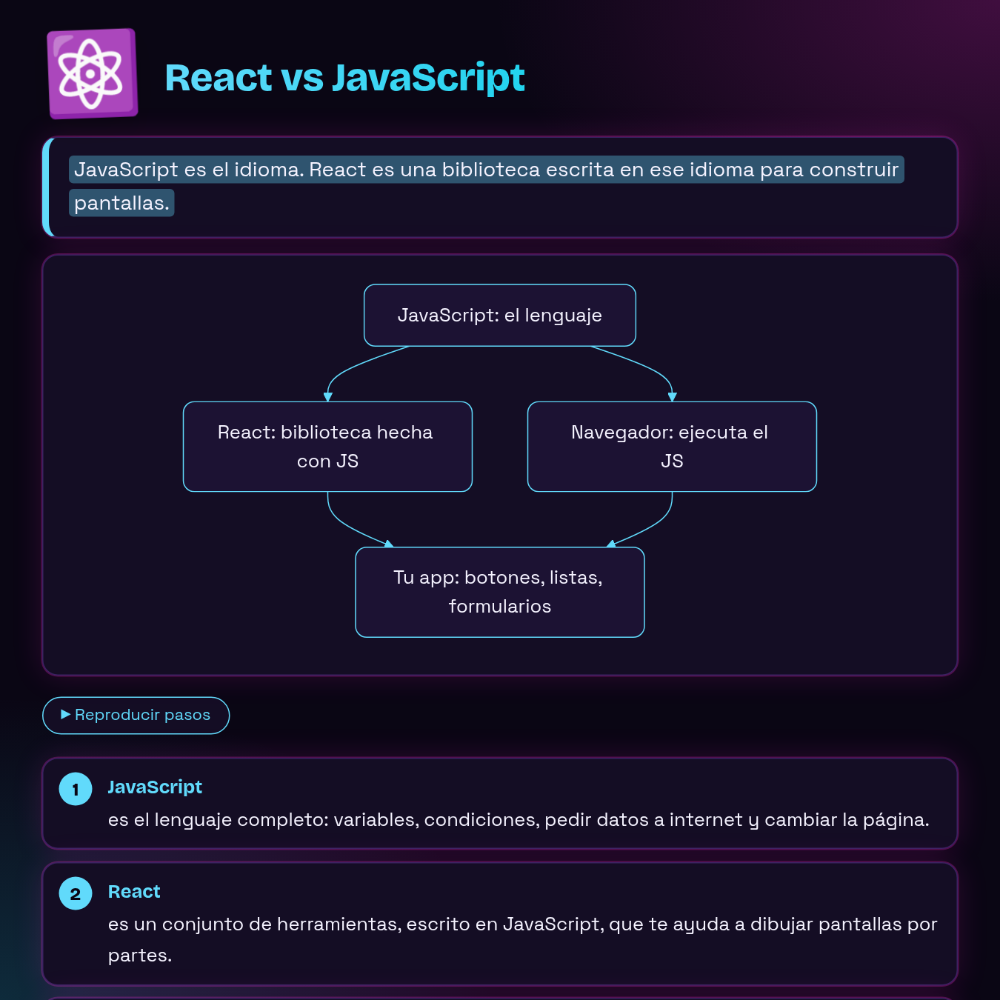
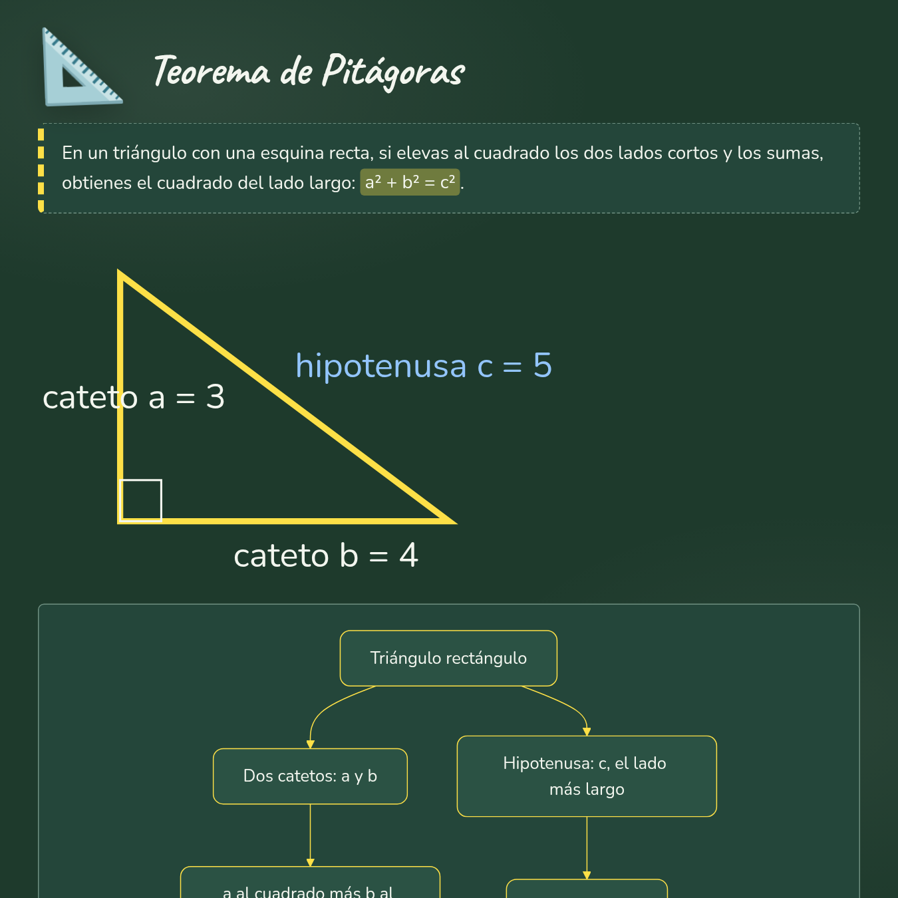
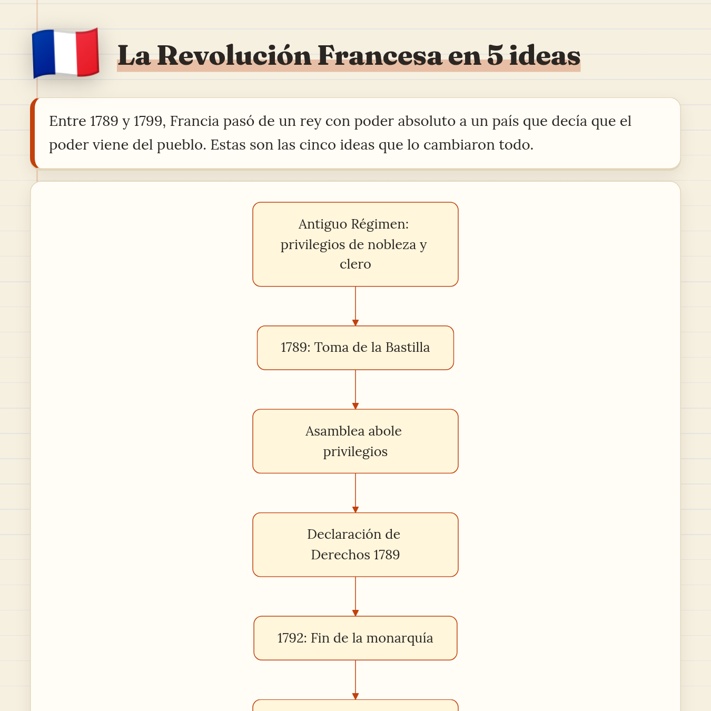
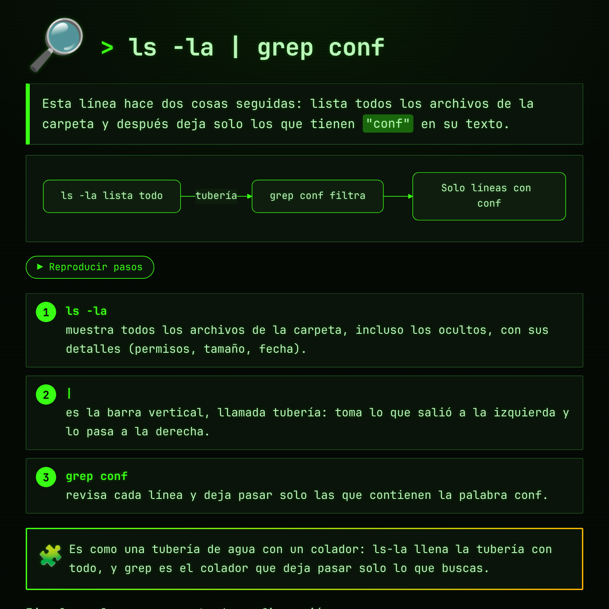
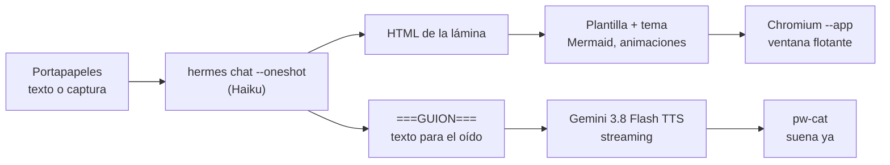

# hermes-learn

> Copia algo que no entiendes, pulsa una tecla, y una profe te lo explica: **lo ves** en una lámina visual y **lo escuchas** a la vez.

`hermes-learn` es un atajo de escritorio (pensado para Linux con Wayland/Hyprland) que toma lo último del portapapeles, sea texto, código, un error o una captura de pantalla, y:

1. **Lo explica en una lámina HTML visual** con [Hermes Agent](https://hermes-agent.nousresearch.com) y un modelo rápido (Claude Haiku por defecto). Usa diagramas Mermaid animados, pasos, tarjetas, comparaciones, post-its, líneas de tiempo y dibujos SVG. Se abre en una ventanita flotante.
2. **Lo narra en voz alta** con **Gemini 3.8 Flash TTS**. El guion no es el mismo texto de la lámina: está escrito para el oído y va señalando lo que ves ("fíjate en el diagrama…"). El audio se reproduce *en streaming*, así que empieza a sonar ~0,3 s después de abrirse la ventana.

Son dos canales de aprendizaje al mismo tiempo: vista y oído.

<p align="center">
  
  
  
  
</p>

## Qué tiene

- **Decide cuánto explicar.** Si es una palabra suelta, da un par de párrafos. Si es código, un error o un proceso, la explicación es visual, con al menos un diagrama.
- **8 temas que elige el modelo según el asunto:** `papel` (cuaderno), `pizarra` (tiza), `blueprint` (plano técnico), `pastel`, `neon` (synthwave), `revista` (editorial), `terminal` (fósforo verde) y `noche`. Rota para no repetir, y puede ajustar el color de acento (por ejemplo, azul React o amarillo JS).
- **Diagramas legibles.** Si un diagrama horizontal no cabe, se redibuja en vertical. Al hacer clic se abre un visor a pantalla completa con zoom (rueda o `+ - 0`) y arrastre.
- **Componentes animados:** pasos que se reproducen uno a uno, una terminal que se escribe sola, nodos que aparecen en orden y flechas en movimiento.
- **Voz configurable.** Puede ser cualquier voz de Gemini o una propia hecha con *Voice design* (`scripts/create_voice.py`). Por defecto es una profe joven con acento latino neutro de doblaje.
- **Funciona sin internet para el HTML.** Mermaid, highlight.js y las fuentes se guardan en local.
- **Historial.** Cada explicación queda en `~/Explicaciones/` (`.html`, `.guion.txt` y `.wav`).
- `Esc` cierra la ventana y la voz se calla.

## Cómo funciona



Una sola llamada al modelo devuelve las dos piezas. La plantilla aporta todo el CSS y el JS, así que el modelo solo escribe HTML semántico, código Mermaid y el guion, que es donde menos se equivoca.

## Instalación

Requisitos: [Hermes Agent](https://hermes-agent.nousresearch.com) configurado, `chromium`, `wl-clipboard`, `pipewire` (`pw-cat`), `python3`, `curl` y, opcionalmente, `imagemagick`.

```bash
git clone https://github.com/oliveralerubio/hermes-learn
cd hermes-learn
./install.sh
```

Después:

1. Pon tu `GEMINI_API_KEY` en `~/.config/hermes-learn/config` (o expórtala en tu entorno).
2. *(Opcional)* Crea tu propia voz: `scripts/create_voice.py "A calm British narrator in his 50s…" en-GB male`
3. Asigna un atajo. En Hyprland (Lua):
   ```lua
   o.bind("SUPER + SHIFT + E", "Explicar portapapeles", "explicar")
   ```
   y pega la regla de [`hypr/ventana-flotante.lua`](hypr/ventana-flotante.lua) para que la ventana flote centrada.
4. Copia algo y pulsa el atajo.

## Configuración

Todo se configura en `~/.config/hermes-learn/config` o con variables de entorno (ver [`config.example`](config.example)):

| Variable | Por defecto | Para qué |
|---|---|---|
| `GEMINI_API_KEY` | — | Voz (Gemini TTS) |
| `EXPLICAR_VOICE` | `Leda` | Voz prediseñada o `voice_…` propia |
| `EXPLICAR_STYLE` | profe joven, cálida | Estilo de locución |
| `EXPLICAR_MODEL` | `anthropic/claude-haiku-5.5` | Modelo que escribe la lámina |
| `EXPLICAR_PROVIDER` | `nous` | Proveedor en Hermes |
| `EXPLICAR_DIR` | `~/Explicaciones` | Historial |
| `EXPLICAR_VOZ` | `1` | `0` = solo HTML |

`explicar-voz --stop` corta la voz desde cualquier sitio.

## Archivos

```
bin/explicar             atajo principal: portapapeles → Hermes → HTML + voz
bin/explicar-voz         Gemini TTS en streaming → pw-cat (+ .wav)
scripts/create_voice.py  crea una voz con Gemini Voice design
scripts/fetch_fonts.py   descarga las fuentes (Google Fonts) para uso offline
hypr/                    regla de ventana flotante y atajo para Hyprland
install.sh               instala scripts y librerías
```

## Licencia

MIT
